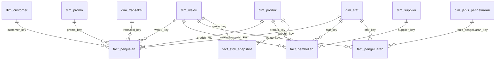

# FORMA Fashion — Sistem Monitoring Transaksi Keuangan & Persediaan UMKM Pakaian + Data Warehouse (OLAP)

**FORMA Fashion** adalah aplikasi web untuk pengelolaan operasional dan analitik **UMKM Pakaian** yang mengintegrasikan dua arsitektur database:
1. **Database Operasional (OLTP — `umkm_pakaian`)**:
   * **E-Commerce Online** untuk pelanggan (`CUSTOMER`)
   * **Point of Sale (POS) Kasir** untuk transaksi toko offline (`KASIR`)
   * **Backoffice Operasional & Kartu Stok** untuk pengelola (`ADMIN`)
2. **Database Analitik (Data Warehouse — `umkm_dw`)**:
   * **Star Schema / Galaxy Schema** (4 tabel fakta: `fact_penjualan`, `fact_pembelian`, `fact_pengeluaran`, `fact_stok_snapshot` & 8 tabel dimensi: `dim_waktu`, `dim_produk`, `dim_customer`, `dim_staf`, `dim_promo`, `dim_transaksi`, `dim_supplier`, `dim_jenis_pengeluaran`)
   * **Pipeline ETL** idempoten (`dw:etl-dimensi`, `dw:etl-penjualan`, `dw:etl-pembelian`, `dw:etl-pengeluaran`, `dw:etl-stok`, `dw:sync`)
   * **OLAP Cube Schema** untuk Mondrian / Pentaho Schema Workbench ([umkm_dw_olap_schema.xml](file:///c:/xampp/htdocs/UMKM/database/dw/umkm_dw_olap_schema.xml))
   * **Dashboard Analitik DW (`/admin/analitik`)** menggunakan Chart.js yang terpisah dari Laporan Operasional OLTP (`/admin/laporan`).

---

## Daftar Isi
- [Teknologi yang Digunakan](#teknologi-yang-digunakan)
- [Hak Akses & Fitur Berdasarkan Peran (RBAC)](#hak-akses--fitur-berdasarkan-peran-rbac)
- [Aturan & Logika Bisnis Inti](#aturan--logika-bisnis-inti)
- [Arsitektur Basis Data](#arsitektur-basis-data)
  - [1. Skema Operasional (OLTP — `umkm_pakaian`)](#1-skema-operasional-oltp--umkm_pakaian)
  - [2. Skema Data Warehouse (Star Schema — `umkm_dw`)](#2-skema-data-warehouse-star-schema--umkm_dw)
- [Proses ETL & OLAP](#proses-etl--olap)
- [Panduan Instalasi & Konfigurasi](#panduan-instalasi--konfigurasi)
- [Akun Demo Bawaan (`PrototypeSeeder`)](#akun-demo-bawaan-prototypeseeder)
- [Pengujian Sistem (`PHPUnit`)](#pengujian-sistem-phpunit)
- [Struktur Direktori Utama](#struktur-direktori-utama)

---

## Teknologi yang Digunakan
* **Backend Framework**: Laravel 12 (`php: ^8.2`)
* **Database Operasional (OLTP)**: MySQL (`umkm_pakaian`)
* **Database Analitik (Data Warehouse)**: MySQL (`umkm_dw`)
* **Frontend**: Laravel Blade + CSS Kustom (`public/css/forma.css`) + **Chart.js 4**
* **ETL Engine**: Laravel Artisan Console Commands (`dw:etl-*`, `dw:sync`) & Scheduler
* **OLAP Cube Schema**: Mondrian / Pentaho Schema Workbench XML (`database/dw/umkm_dw_olap_schema.xml`) & DDL SQL (`database/dw/umkm_dw_schema.sql`)
* **Testing**: PHPUnit 11 (`FinalSystemSmokeTest` & `DataWarehouseEtlTest`)

---

## Hak Akses & Fitur Berdasarkan Peran (RBAC)

Sistem menerapkan satu pintu autentikasi (`/login`) yang menerima **ID Akun**, **Username**, atau **Email**, lalu mengarahkan pengguna sesuai `tipe_akun` melalui `RoleMiddleware`:

### 1. Publik / Pengunjung (`/`)
* **Landing Page (`home.blade.php`)**: Menampilkan 4 produk aktif terbaru yang masih memiliki stok varian `> 0`.
* **Login & Registrasi (`/login`, `/register`)**: Pendaftaran mandiri untuk akun `CUSTOMER` baru.

### 2. Customer (`CUSTOMER` — Prefix `/customer`)
* **Dashboard Pelanggan**: Saldo poin member, top best seller, dan ringkasan pesanan.
* **Katalog, Promo & Detail Produk (`/customer/katalog`, `/customer/promo`, `/customer/produk/{id}`)**: Pencarian, filter kategori, informasi harga diskon promo aktif, serta pemilihan varian ukuran dan warna.
* **Keranjang Belanja (`/customer/keranjang`)**: Pengelolaan keranjang berbasis session dengan validasi stok varian.
* **Checkout & Simulasi Pembayaran QR (`/customer/checkout`, `/customer/pembayaran/{id}`)**: Alamat pengiriman, redeem poin, serta simulasi bayar `BERHASIL` / `GAGAL`.
* **Manajemen Pesanan & Profil (`/customer/pesanan`, `/customer/profil`)**: Pelacakan status (`BARU` → `DIPROSES` → `DIKIRIM` → `SELESAI` atau `BATAL`), pembatalan pesanan `MENUNGGU`, dan pembaruan profil.

### 3. Kasir (`KASIR` — Prefix `/kasir`)
* **Dashboard & Riwayat Kasir (`/kasir`, `/kasir/riwayat`)**: Pantauan transaksi kasir.
* **Point of Sale / POS Offline (`/kasir/pos`)**: Pemilihan produk & varian, penautan member (`CUSTOMER`) atau pembeli *guest* non-member, redeem/earn poin, pilihan pembayaran `TUNAI` atau `QR`, dan cetak struk (`/kasir/struk/{id}`).

### 4. Admin (`ADMIN` — Prefix `/admin`)
* **Dashboard Admin (`/admin`)**: Ringkasan penjualan, transaksi, produk, pelanggan, stok menipis, dan transaksi terbaru.
* **Master Data**: Akun Staf (`/admin/akun`), Kategori (`/admin/kategori`), Produk & Varian (`/admin/produk`), serta Supplier (`/admin/supplier`).
* **Pembelian / Restock (`/admin/pembelian`)**: Pembuatan PO (`DIPESAN`), penerimaan barang (`DITERIMA`, mengisi `tanggal_diterima`, menambah stok varian, mencatat riwayat `mutasi_stok` `MASUK`, serta membuat `pengeluaran` `PEMBELIAN_PRODUK` otomatis), dan pembatalan (`BATAL`).
* **Monitoring Penjualan (`/admin/penjualan`)**: Filter kanal & status bayar serta pembaruan status pesanan online berbayar (`DIPROSES` → `DIKIRIM` → `SELESAI`).
* **Promo & Pengeluaran (`/admin/promo`, `/admin/pengeluaran`)**: Kampanye promo diskon persentase per periode dan pencatatan pengeluaran operasional manual (`LISTRIK`, `INTERNET`, `SEWA`, `ONGKIR`, `PERAWATAN`, `LAINNYA`).
* **Laporan Operasional OLTP (`/admin/laporan` — `ReportController`)**: Ringkasan keuangan real-time, produk *best seller*, dan daftar stok minimum langsung dari `umkm_pakaian`.
* **Dashboard Analitik Data Warehouse (`/admin/analitik` — `AnalyticsController`)**:
  * Membaca **hanya dari koneksi `dw` (`umkm_dw`)**.
  * Dilengkapi filter **Slice & Dice** (`Tahun`, `Kuartal`, `Kategori`, `Kanal`) serta tombol **`↻ Refresh Data Warehouse (ETL)`**.
  * Grafik **Chart.js**: Tren Omzet & Laba Kotor bulanan (Q1), Arus Kas Bulanan / Drill-across (Q11), Omzet per Kategori (Q2), Hari Teramai Senin–Minggu (Q8), Kanal & Metode Bayar (Q4), Member vs Guest (Q6), serta tabel Top 10 Produk (Q2), Pivot Ukuran × Warna (Q3), Efektivitas Promo (Q5), Top Customer (Q6), Kinerja Kasir (Q7), Pembelian Supplier (Q9), Pengeluaran per Jenis (Q10), dan Snapshot Stok Minimum (Q12).

---

## Aturan & Logika Bisnis Inti

1. **`PricingService` (`app/Services/PricingService.php`)**:
   * Menentukan promo aktif dengan diskon persentase terbesar untuk setiap produk (`activePromo()`).
   * Menyimpan *snapshot* `harga_normal`, `harga_satuan` (setelah promo), `persen_diskon`, dan `id_promo` pada `detail_penjualan`.
2. **`PointService` (`app/Services/PointService.php`)**:
   * `1 Poin = Rp500` (`POINT_VALUE = 500`).
   * Perolehan `1 Poin` tiap kelipatan `Rp10.000` (`EARN_PER_RUPIAH = 10000`) dari subtotal setelah diskon promo (sebelum redeem poin) pada transaksi `BERHASIL` & bukan `BATAL` (online maupun offline via `penjualan_member`).
3. **`SaleService` (`app/Services/SaleService.php`)**:
   * Menggunakan `DB::transaction` dan `lockForUpdate()` saat memvalidasi stok & poin, mengurangi `varian_produk.stok`, serta mencatat histori keluar barang pada `mutasi_stok` (`KELUAR`).

---

## Arsitektur Basis Data

### 1. Skema Operasional (OLTP — `umkm_pakaian`)
Lokasi migrasi: `database/migrations/` (14 tabel: 13 tabel transaksi utama + tabel kartu stok `mutasi_stok`).

* `akun`, `kategori_produk`, `produk`, `varian_produk`, `supplier`
* `pembelian_produk` (dilengkapi `tanggal_diterima`), `detail_pembelian`
* `penjualan`, `penjualan_member`, `detail_penjualan` (dilengkapi `harga_normal`, `persen_diskon`, `id_promo`)
* `pengeluaran`, `promo`, `promo_produk`, `mutasi_stok` (`MASUK`, `KELUAR`, `PENYESUAIAN`)

### 2. Skema Data Warehouse (Star Schema — `umkm_dw`)
Lokasi migrasi: `database/migrations/dw/` · DDL SQL: `database/dw/umkm_dw_schema.sql`



#### Tabel Dimensi (`dim_*`)
1. **`dim_waktu`**: `waktu_key` (`YYYYMMDD`), `tanggal`, `hari`, `nama_hari`, `hari_dalam_minggu` (1–7), `is_akhir_pekan`, `minggu_dalam_tahun`, `bulan`, `nama_bulan`, `kuartal`, `semester`, `tahun`.
2. **`dim_produk`**: Denormalisasi `varian_produk` + `produk` + `kategori_produk` (`produk_key`, `id_varian`, `ukuran`, `warna`, `stok_minimum`, `id_produk`, `nama_produk`, `harga_jual`, `status_produk`, `id_kategori`, `nama_kategori`).
3. **`dim_customer`**: `customer_key` (key `0` = `GUEST / Non-member`), `id_akun`, `nama`, `username`, `status_akun`, `tanggal_daftar`, `tahun_daftar`.
4. **`dim_staf`**: `staf_key` (key `0` = `Tidak ada (online)`), `id_akun`, `nama`, `peran`, `status_akun`.
5. **`dim_promo`**: `promo_key` (key `0` = `Tanpa promo`), `id_promo`, `nama_promo`, `persen_diskon`, `tanggal_mulai`, `tanggal_selesai`, `durasi_hari`, `kelompok_diskon`.
6. **`dim_transaksi`** (*junk dimension*): `transaksi_key` (1–4) kombinasi `kanal_penjualan` × `metode_pembayaran`.
7. **`dim_supplier`**: `supplier_key`, `id_supplier`, `nama_supplier`, `alamat`.
8. **`dim_jenis_pengeluaran`**: `jenis_pengeluaran_key` (1–7), `jenis_pengeluaran`, `kelompok` (`PEMBELIAN STOK` / `OPERASIONAL`).

#### Tabel Fakta (`fact_*`)
1. **`fact_penjualan`** (*grain*: 1 varian dalam 1 transaksi `BERHASIL` & bukan `BATAL`): `jumlah`, `harga_normal`, `harga_satuan`, `diskon_promo`, `subtotal`, `diskon_poin`, `pendapatan_bersih`, `hpp` (rata-rata tertimbang harga beli `DITERIMA`), `laba_kotor`.
2. **`fact_pembelian`** (*grain*: 1 varian dalam 1 PO `DITERIMA`): `jumlah`, `harga_beli`, `total_biaya`.
3. **`fact_pengeluaran`** (*grain*: 1 pencatatan pengeluaran): `nominal`.
4. **`fact_stok_snapshot`** (*periodic snapshot*): `stok`, `stok_minimum`, `is_low_stock`.

---

## Proses ETL & OLAP

```bash
# 1. Jalankan ETL seluruh tabel dimensi terlebih dahulu
php artisan dw:etl-dimensi

# 2. Jalankan ETL masing-masing tabel fakta (atau tambah --skip-dims jika dimensi sudah diperbarui)
php artisan dw:etl-penjualan
php artisan dw:etl-pembelian
php artisan dw:etl-pengeluaran
php artisan dw:etl-stok

# 3. Atau jalankan seluruh pipeline ETL berurutan sekaligus
php artisan dw:sync
```

* **Penjadwalan**: `dw:sync` dijadwalkan per jam di `routes/console.php`.
* **Skema OLAP Cube (Mondrian / Schema Workbench)**: Tersedia pada `database/dw/umkm_dw_olap_schema.xml` dengan 3 cube (`Penjualan`, `Pembelian`, `Pengeluaran`).

---

## Panduan Instalasi & Konfigurasi

### 1. Buat Database & Atur `.env`
Buat dua database di MySQL/phpMyAdmin: `umkm_pakaian` (OLTP) dan `umkm_dw` (DW).
```env
DB_CONNECTION=mysql
DB_HOST=127.0.0.1
DB_PORT=3306
DB_DATABASE=umkm_pakaian
DB_USERNAME=root
DB_PASSWORD=

DB_DW_HOST=127.0.0.1
DB_DW_PORT=3306
DB_DW_DATABASE=umkm_dw
DB_DW_USERNAME=root
DB_DW_PASSWORD=
```

### 2. Migrasi, Seeder 12 Bulan, & ETL
```bash
composer install
php artisan key:generate

# Migrasi & seed database OLTP (32 produk, 6 kategori, 160 customer, 10 promo, data 12 bulan)
php artisan migrate:fresh --seed

# Migrasi star schema pada database Data Warehouse
php artisan migrate:fresh --database=dw --path=database/migrations/dw

# Isi Data Warehouse lewat pipeline ETL
php artisan dw:sync

# Jalankan server
php artisan serve
```

---

## Akun Demo Bawaan (`PrototypeSeeder`)

| Peran (`tipe_akun`) | ID Akun | Username | Email | Password | Status |
| :--- | :--- | :--- | :--- | :--- | :--- |
| **ADMIN** | `ADM021` | `admin` | `admin@forma.local` | `admin123` | `AKTIF` |
| **ADMIN** | `ADM022` | `dinda_adm` | `dinda@forma.local` | `admin123` | `AKTIF` |
| **KASIR** | `KSR001` | `siti` | `siti.amalia@example.com` | `kasir123` | `AKTIF` |
| **KASIR** | `KSR002` | `rizky` | `rizky.ramadhan@example.com` | `kasir123` | `AKTIF` |
| **KASIR** | `KSR003` | `nabila` | `nabila.rahma@example.com` | `kasir123` | `NONAKTIF` |
| **KASIR** | `KSR004` | `bagas` | `bagas.pratama@example.com` | `kasir123` | `AKTIF` |
| **CUSTOMER** | `CUST123` | `budi` | `budi.santoso@example.com` | `budi123` | `AKTIF` |
| **CUSTOMER** | `CUST124` | `alya` | `alya.putri@example.com` | `alya123` | `AKTIF` |
| **CUSTOMER** | `CUST125` | `raka` | `raka.mahendra@example.com` | `raka123` | `AKTIF` |
| **CUSTOMER** | `CUST126` | `nadia` | `nadia.prameswari@example.com` | `nadia123` | `AKTIF` |

*(Plus `CUST201` s.d. `CUST356` dengan password default `customer123`.)*

---

## Pengujian Sistem (`PHPUnit`)

```bash
php artisan test
```
* **`tests/Feature/FinalSystemSmokeTest.php`**: Pengujian RBAC, restock pembelian (`tanggal_diterima` + `mutasi_stok`), validasi poin, checkout online/POS offline, serta penyimpanan `harga_normal`, `persen_diskon`, & `id_promo`.
* **`tests/Feature/DataWarehouseEtlTest.php`**: Rekonsiliasi OLTP vs DW (`fact_penjualan`, `fact_pembelian`, `fact_pengeluaran`, `fact_stok_snapshot`), uji *zero-key* (`key = 0`), idempotensi & inkremental ETL, uji query OLAP (`roll-up`, `drill-down`, `pivot`), serta proteksi RBAC pada `/admin/analitik` dan `/admin/laporan`.
