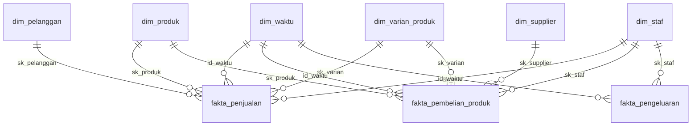

# FORMA Fashion — Sistem Informasi Manajemen UMKM Pakaian & Data Warehouse (OLAP)

**FORMA Fashion** adalah aplikasi berbasis web untuk pengelolaan operasional **UMKM Pakaian** yang mengintegrasikan:
1. **E-Commerce Online** untuk pelanggan (`CUSTOMER`),
2. **Point of Sale (POS) Kasir** untuk transaksi toko offline (`KASIR`),
3. **Backoffice & Manajemen Operasional** untuk pengelola (`ADMIN`), serta
4. **Data Warehouse (Star Schema), Pipeline ETL, & Dashboard Analitik OLAP** pada basis data terpisah (`umkm_dw`).

Aplikasi ini dibangun menggunakan **Laravel 12**, **PHP 8.2+**, **Blade**, dan **MySQL** (dua koneksi database: transaksional OLTP dan analitis OLAP/DW).

---

## Daftar Isi
- [Teknologi yang Digunakan](#teknologi-yang-digunakan)
- [Hak Akses & Fitur Berdasarkan Peran (RBAC)](#hak-akses--fitur-berdasarkan-peran-rbac)
- [Aturan & Logika Bisnis Inti](#aturan--logika-bisnis-inti)
- [Arsitektur Basis Data](#arsitektur-basis-data)
  - [1. Skema Operasional (OLTP — `umkm_pakaian`)](#1-skema-operasional-oltp--umkm_pakaian)
  - [2. Skema Data Warehouse (Star Schema — `umkm_dw`)](#2-skema-data-warehouse-star-schema--umkm_dw)
- [Proses ETL & OLAP](#proses-etl--olap)
- [Panduan Instalasi & Konfigurasi](#panduan-instalasi--konfigurasi)
- [Akun Demo Bawaan (`PrototypeSeeder`)](#akun-demo-bawaan-prototypeseeder)
- [Pengujian Sistem (`PHPUnit`)](#pengujian-sistem-phpunit)
- [Struktur Direktori Utama](#struktur-direktori-utama)

---

## Teknologi yang Digunakan
* **Backend Framework**: Laravel 12 (`php: ^8.2`)
* **Database Operasional (OLTP)**: MySQL (`umkm_pakaian`)
* **Database Analitik (Data Warehouse)**: MySQL (`umkm_dw`)
* **Frontend**: Laravel Blade + CSS Kustom (`public/css/forma.css`) + Grafik SVG Interaktif
* **ETL Engine**: Laravel Artisan Console Commands (`dw:etl-pembelian`, `dw:etl-penjualan`, `dw:etl-pengeluaran`, `dw:sync`) & Scheduler
* **OLAP Cube Schema**: Mondrian / Pentaho Schema Workbench XML (`database/dw/umkm_dw_olap_schema.xml`)
* **Testing**: PHPUnit 11 (`FinalSystemSmokeTest` & `DataWarehouseEtlTest`)

---

## Hak Akses & Fitur Berdasarkan Peran (RBAC)

Sistem menerapkan satu pintu autentikasi (`/login`) yang menerima **ID Akun**, **Username**, atau **Email**, lalu mengarahkan pengguna sesuai `tipe_akun` yang dilindungi oleh `RoleMiddleware`:

### 1. Publik / Pengunjung (`/`)
* **Landing Page (`home.blade.php`)**: Menampilkan 4 produk aktif terbaru yang masih memiliki stok varian `> 0`.
* **Login & Registrasi (`/login`, `/register`)**: Pendaftaran mandiri untuk membuat akun `CUSTOMER` baru dengan penomoran otomatis (`CUST001`, `CUST002`, dst.).

### 2. Customer (`CUSTOMER` — Prefix `/customer`)
* **Dashboard Pelanggan**: Ringkasan saldo poin member, pesanan terbaru, dan pintasan belanja.
* **Katalog & Detail Produk (`/customer/katalog`, `/customer/produk/{id}`)**: Pencarian produk, filter kategori, informasi harga diskon promo aktif, dan pilihan varian ukuran/warna beserta stoknya.
* **Halaman Promo (`/customer/promo`)**: Daftar promo diskon yang sedang berlangsung beserta produk yang termasuk di dalamnya.
* **Keranjang Belanja (`/customer/keranjang`)**: Tambah, ubah jumlah, hapus item, atau kosongkan keranjang berbasis session dengan validasi ketersediaan stok.
* **Checkout & Simulasi Pembayaran QR (`/customer/checkout`, `/customer/pembayaran/{id}`)**:
  * Input alamat pengiriman dan opsi penukaran (**redeem**) poin member.
  * Simulasi konfirmasi pembayaran QR (**Berhasil** atau **Gagal**).
* **Manajemen Pesanan (`/customer/pesanan`)**: Melacak status pesanan (`BARU` → `DIPROSES` → `DIKIRIM` → `SELESAI` atau `BATAL`) dan membatalkan pesanan yang masih berstatus `MENUNGGU`.
* **Profil (`/customer/profil`)**: Memperbarui informasi nama, kontak, alamat, dan kata sandi.

### 3. Kasir (`KASIR` — Prefix `/kasir`)
* **Dashboard & Riwayat Kasir (`/kasir`, `/kasir/riwayat`)**: Ringkasan transaksi harian yang dilayani oleh kasir terkait.
* **Point of Sale / POS Offline (`/kasir/pos`)**:
  * Pencarian produk dan filter kategori (1 kartu per produk dengan daftar pilihan varian ukuran/warna yang tersedia).
  * Pengelolaan keranjang POS berbasis session (`pos_cart`).
  * **Pencarian & Penautan Member (`CUSTOMER`)**: Mencari member berdasarkan `id_akun`, `username`, `email`, atau `no_telp` untuk menampilkan saldo poin, menggunakan poin, serta memberikan poin dari transaksi POS (atau melanjutkan sebagai pembeli *guest* non-member).
  * Pilihan metode pembayaran **`TUNAI`** atau **`QR`**.
* **Struk Transaksi (`/kasir/struk/{id}`)**: Menampilkan rincian struk penjualan offline setelah checkout selesai.

### 4. Admin (`ADMIN` — Prefix `/admin`)
* **Dashboard Admin (`/admin`)**: Ringkasan total penjualan, jumlah transaksi, total produk, total pelanggan, daftar varian yang stoknya hampir habis (`<= stok_minimum`), dan transaksi terbaru.
* **Manajemen Master Data**:
  * **Akun Staf (`/admin/akun`)**: CRUD akun `ADMIN` dan `KASIR`, serta aktivasi/nonaktivasi status akun (`AKTIF` / `NONAKTIF`).
  * **Kategori Produk (`/admin/kategori`)**: CRUD kategori pakaian (dilindungi agar kategori yang sudah dipakai produk tidak bisa dihapus).
  * **Produk & Varian (`/admin/produk`, `/admin/produk/{id}/varian`)**: CRUD produk beserta gambar, status (`AKTIF` / `NONAKTIF`), dan varian (`ukuran`, `warna`, `stok`, `stok_minimum`). Varian yang sudah memiliki riwayat transaksi dilindungi dari penghapusan.
  * **Supplier (`/admin/supplier`)**: Pencatatan dan pembaruan data pemasok barang.
* **Pembelian / Restock Produk (`/admin/pembelian`)**:
  * Membuat pesanan pembelian multi-varian ke supplier dengan status awal `DIPESAN` (stok belum bertambah).
  * Aksi **Terima Barang (`DITERIMA`)**: Menambah stok tiap varian secara otomatis dan **mencatat pengeluaran otomatis** bertipe `PEMBELIAN_PRODUK` pada tabel `pengeluaran`.
  * Aksi **Batalkan (`BATAL`)** untuk pembelian yang masih berstatus `DIPESAN`.
* **Monitoring Penjualan (`/admin/penjualan`)**:
  * Filter transaksi berdasarkan kanal (`ONLINE` / `OFFLINE`) dan status pembayaran (`MENUNGGU`, `BERHASIL`, `GAGAL`).
  * Memperbarui status pengiriman pesanan online yang sudah dibayar secara berurutan (`DIPROSES` → `DIKIRIM` → `SELESAI`).
* **Manajemen Promo (`/admin/promo`)**: Membuat dan mengubah promo diskon persentase (`persen_diskon`) berdasarkan rentang tanggal aktif dan daftar produk.
* **Pengeluaran Operasional (`/admin/pengeluaran`)**: Mencatat dan mengubah pengeluaran operasional manual (`LISTRIK`, `INTERNET`, `SEWA`, `ONGKIR`, `PERAWATAN`, `LAINNYA`). Pengeluaran otomatis dari pembelian produk dikunci agar tidak diedit manual.
* **Monitoring Laporan & Dashboard Analitik Data Warehouse (`/admin/laporan`)**:
  * Ringkasan arus kas operasional, produk *best seller*, dan peringatan stok minimum.
  * **Tombol `↻ Sync Data Warehouse (ETL)`** untuk menjalankan ETL langsung dari antarmuka web.
  * **Dashboard Analitik OLAP** yang membaca langsung dari database `umkm_dw` lengkap dengan filter *slicing & dicing* (`Rentang Waktu`, `Tahun`, `Kuartal`, `Bulan`, `Kanal`, `Kategori`) dan grafik visualisasi.

---

## Aturan & Logika Bisnis Inti

Seluruh perhitungan harga, promo, poin, dan mutasi stok dipusatkan di `app/Services`:

1. **`PricingService` (`app/Services/PricingService.php`)**:
   * Mengambil diskon persentase tertinggi dari promo yang sedang aktif (`tanggal_mulai <= now() <= tanggal_selesai`) untuk suatu produk.
   * Harga satuan disimpan sebagai *snapshot* pada `detail_penjualan.harga_satuan` saat transaksi dibuat.
2. **`PointService` (`app/Services/PointService.php`)**:
   * **Nilai Tukar Poin**: `1 Poin = Rp500` (`POINT_VALUE = 500`).
   * **Perolehan Poin**: `1 Poin` diperoleh setiap kelipatan **`Rp10.000`** (`EARN_PER_RUPIAH = 10000`) dari **subtotal setelah diskon promo (sebelum dikurangi diskon redeem poin)**.
   * **Saldo Poin**: Dihitung secara dinamis dari seluruh transaksi berstatus `status_pembayaran = BERHASIL` dan `status_penjualan != BATAL` milik customer, baik dari transaksi `ONLINE` (`penjualan.id_akun`) maupun `OFFLINE` (`penjualan_member.id_akun_customer`).
3. **`SaleService` (`app/Services/SaleService.php`)**:
   * Menggunakan transaksi database (`DB::transaction`) dan *row-level locking* (`lockForUpdate()`) pada akun customer dan varian produk.
   * Pada pesanan **Online**, stok varian dan perolehan poin baru dieksekusi ketika pembayaran dinyatakan **`BERHASIL`** (`payOnline`). Jika pembayaran **`GAGAL`** atau pesanan **`BATAL`** saat masih menunggu, stok dan poin tidak berubah.
   * Pada transaksi **Offline (POS)**, validasi stok, pengurangan stok, pemotongan poin, dan pencatatan poin berlangsung seketika saat kasir menekan checkout (`checkoutOffline`).

---

## Arsitektur Basis Data

### 1. Skema Operasional (OLTP — `umkm_pakaian`)
Lokasi migrasi: `database/migrations/`

| Tabel | Primary Key | Deskripsi |
| :--- | :--- | :--- |
| `akun` | `id_akun` | Data pengguna (`ADMIN`, `KASIR`, `CUSTOMER`) beserta kredensial dan status. |
| `kategori_produk` | `id_kategori` | Master kategori pakaian (`Kaos`, `Hoodie`, `Sweater`, `Kemeja`, `Celana`, dll.). |
| `produk` | `id_produk` | Master produk, harga jual dasar, deskripsi, gambar, dan status produk. |
| `varian_produk` | `id_varian` | Varian ukuran & warna per produk beserta `stok` dan `stok_minimum`. |
| `supplier` | `id_supplier` | Data pemasok untuk pembelian/restock barang. |
| `pembelian_produk` | `id_pembelian` | Header transaksi pembelian ke supplier (`DIPESAN`, `DITERIMA`, `BATAL`). |
| `detail_pembelian` | `id_detail_pembelian` | Rincian varian, jumlah, dan harga beli satuan pada tiap PO. |
| `penjualan` | `id_penjualan` | Header transaksi penjualan (`ONLINE` / `OFFLINE`, metode & status bayar, poin, diskon poin). |
| `penjualan_member` | `id_penjualan` | Tabel penghubung transaksi POS `OFFLINE` dengan akun member `CUSTOMER`. |
| `detail_penjualan` | `id_detail_penjualan` | Rincian varian, jumlah, dan *snapshot* harga satuan setelah promo. |
| `pengeluaran` | `id_pengeluaran` | Pencatatan pengeluaran operasional manual maupun otomatis dari penerimaan PO (`PEMBELIAN_PRODUK`). |
| `promo` | `id_promo` | Master kampanye promo diskon persen dan periode berlakunya. |
| `promo_produk` | `(id_promo, id_produk)` | Relasi produk yang termasuk dalam suatu promo. |

---

### 2. Skema Data Warehouse (Star Schema — `umkm_dw`)
Lokasi migrasi: `database/migrations/dw/` (koneksi database: `dw`)



#### Tabel Dimensi (`dim_*`)
1. **`dim_waktu`**: `id_waktu` (`YYYYMMDD`), `tanggal`, `nama_hari`, `bulan`, `nama_bulan`, `kuartal`, `tahun`.
2. **`dim_produk`**: `sk_produk` (surrogate key), `id_produk`, `nama_produk`, `kategori` (denormalisasi dari `produk` + `kategori_produk`), `harga_jual`.
3. **`dim_varian_produk`**: `sk_varian`, `id_varian`, `ukuran`, `warna`.
4. **`dim_supplier`**: `sk_supplier`, `id_supplier`, `nama_supplier`, `kota_supplier`, `no_telp`.
5. **`dim_staf`**: `sk_staf`, `id_akun`, `nama_staf`, `tipe_akun` (`ADMIN` / `KASIR`), `email`.
6. **`dim_pelanggan`**: `sk_pelanggan`, `id_akun` (`CUSTOMER`), `nama_pelanggan`, `tanggal_daftar`.

#### Tabel Fakta (`fakta_*`)
1. **`fakta_penjualan`**:
   * *Grain*: 1 baris per item detail penjualan yang valid (`status_pembayaran = BERHASIL` dan `status_penjualan != BATAL`).
   * *Foreign Keys*: `id_waktu`, `sk_produk`, `sk_varian`, `sk_pelanggan` (nullable untuk pembeli offline non-member), `sk_staf` (nullable untuk transaksi online).
   * *Degenerate Dimensions*: `no_penjualan`, `kanal_penjualan` (`ONLINE` / `OFFLINE`), `metode_pembayaran` (`QR` / `TUNAI`).
   * *Measures*: `jumlah_terjual`, `harga_satuan`, `subtotal_item`, `diskon_poin_alokasi` (alokasi proporsional diskon poin ke tiap baris), `total_bersih_item`.
2. **`fakta_pembelian_produk`**:
   * *Grain*: 1 baris per item detail pembelian yang telah diterima (`status_pembelian = DITERIMA`).
   * *Foreign Keys*: `id_waktu`, `sk_supplier`, `sk_produk`, `sk_varian`, `sk_staf`.
   * *Measures*: `jumlah_dibeli`, `harga_satuan`, `total_biaya_pembelian`.
3. **`fakta_pengeluaran`**:
   * *Grain*: 1 baris per transaksi pengeluaran pada tabel `pengeluaran`.
   * *Foreign Keys*: `id_waktu`, `sk_staf`.
   * *Dimensi Klasifikasi*: `kategori_biaya` (`RESTOCK_PRODUK` vs `OPERASIONAL`), `jenis_pengeluaran`.
   * *Measures*: `nominal_pengeluaran`.

---

## Proses ETL & OLAP

Proyek ini menyediakan 3 perintah ETL spesifik dan 1 perintah gabungan yang bersifat **idempoten** (menggunakan `updateOrInsert` sehingga aman dijalankan berulang kali tanpa menimbulkan duplikasi data):

```bash
# 1. ETL Pembelian Produk (dim_supplier, dim_produk, dim_varian_produk, dim_staf, dim_waktu -> fakta_pembelian_produk)
php artisan dw:etl-pembelian

# 2. ETL Penjualan (dim_produk, dim_varian_produk, dim_staf, dim_pelanggan, dim_waktu -> fakta_penjualan)
php artisan dw:etl-penjualan

# 3. ETL Pengeluaran (dim_staf, dim_waktu -> fakta_pengeluaran)
php artisan dw:etl-pengeluaran

# 4. Jalankan seluruh pipeline ETL sekaligus
php artisan dw:sync
```

* **Trigger dari Web Admin**: Admin dapat menekan tombol **`↻ Sync Data Warehouse (ETL)`** di halaman `/admin/laporan` untuk memicu migrasi dan seluruh proses ETL secara langsung.
* **Penjadwalan Otomatis**: Ketiga command ETL telah didaftarkan pada scheduler Laravel (`->hourly()`) di `routes/console.php`.
* **Skema OLAP Cube (Mondrian / Pentaho Schema Workbench)**: Tersedia pada file `database/dw/umkm_dw_olap_schema.xml` yang mendefinisikan 3 Cube (`fakta_penjualan`, `fakta_pembelian_produk`, `fakta_pengeluaran`).

---

## Panduan Instalasi & Konfigurasi

### 1. Prasyarat
* PHP `>= 8.2`
* Composer
* MySQL / MariaDB (misalnya melalui XAMPP)

### 2. Konfigurasi Database di `.env`
Buat dua database di MySQL/phpMyAdmin:
* `umkm_pakaian` (untuk operasional OLTP)
* `umkm_dw` (untuk Data Warehouse)

Pastikan pengaturan di file `.env` sesuai:
```env
DB_CONNECTION=mysql
DB_HOST=127.0.0.1
DB_PORT=3306
DB_DATABASE=umkm_pakaian
DB_USERNAME=root
DB_PASSWORD=

DW_DB_HOST=127.0.0.1
DW_DB_PORT=3306
DW_DB_DATABASE=umkm_dw
DW_DB_USERNAME=root
DW_DB_PASSWORD=
```

### 3. Jalankan Migrasi, Seeder, dan ETL
```bash
# Install dependensi PHP
composer install

# Generate application key (jika belum ada)
php artisan key:generate

# Migrasi & isi data awal database operasional (umkm_pakaian)
php artisan migrate --seed

# Migrasi tabel Star Schema pada database Data Warehouse (umkm_dw)
php artisan migrate --database=dw --path=database/migrations/dw

# Jalankan ETL untuk memuat data ke Data Warehouse
php artisan dw:sync

# Jalankan server lokal
php artisan serve
```

---

## Akun Demo Bawaan (`PrototypeSeeder`)

Setelah menjalankan `php artisan migrate --seed`, Anda dapat login di `/login` menggunakan akun berikut:

| Peran (`tipe_akun`) | ID Akun | Username | Email | Password | Status |
| :--- | :--- | :--- | :--- | :--- | :--- |
| **ADMIN** | `ADM021` | `admin` | `admin@forma.local` | `admin123` | `AKTIF` |
| **KASIR** | `KSR001` | `siti` | `siti.amalia@example.com` | `kasir123` | `AKTIF` |
| **KASIR** | `KSR002` | `rizky` | `rizky.ramadhan@example.com` | `kasir123` | `AKTIF` |
| **KASIR** | `KSR003` | `nabila` | `nabila.rahma@example.com` | `kasir123` | `NONAKTIF` |
| **CUSTOMER** | `CUST123` | `budi` | `budi.santoso@example.com` | `budi123` | `AKTIF` |
| **CUSTOMER** | `CUST124` | `alya` | `alya.putri@example.com` | `alya123` | `AKTIF` |
| **CUSTOMER** | `CUST125` | `raka` | `raka.mahendra@example.com` | `raka123` | `AKTIF` |
| **CUSTOMER** | `CUST126` | `nadia` | `nadia.prameswari@example.com` | `nadia123` | `AKTIF` |

---

## Pengujian Sistem (`PHPUnit`)

Proyek ini dilengkapi pengujian otomatis untuk memverifikasi alur operasional (OLTP) maupun akurasi Data Warehouse (ETL & OLAP):

```bash
php artisan test
```

Cakupan pengujian meliputi:
1. **`tests/Feature/FinalSystemSmokeTest.php`**:
   * Redirect login untuk setiap role (`CUSTOMER`, `KASIR`, `ADMIN`) dan proteksi lintas role (`RoleMiddleware`).
   * Penerimaan pembelian produk (`DITERIMA`) menambah stok varian tepat satu kali dan membuat catatan pengeluaran otomatis (`PEMBELIAN_PRODUK`).
   * Revalidasi saldo poin saat pembayaran online diselesaikan.
   * Pembayaran online gagal atau dibatalkan tidak mengubah stok maupun poin.
   * Transaksi POS offline untuk pembeli *guest* vs *member* (`penjualan_member`).
   * Penyimpanan *snapshot* harga diskon promo pada `detail_penjualan`.
   * Proteksi penghapusan kategori dan varian yang sudah digunakan.
2. **`tests/Feature/DataWarehouseEtlTest.php`**:
   * Eksekusi `dw:etl-pembelian`, `dw:etl-penjualan`, dan `dw:etl-pengeluaran` serta verifikasi rekonsiliasi total bersih DW terhadap `nominal_bayar` OLTP.
   * Uji akurasi penambahan transaksi baru (*incremental load*) dan uji idempotensi (eksekusi ETL berulang tidak menduplikasi baris fakta).
   * Uji sinkronisasi ETL dan filter *slicing & dicing* pada Dashboard Analitik Admin (`/admin/laporan`).

---

## Struktur Direktori Utama

```text
├── app/
│   ├── Console/Commands/
│   │   ├── EtlPembelian.php       # ETL pembelian DITERIMA -> fakta_pembelian_produk
│   │   ├── EtlPenjualan.php       # ETL penjualan BERHASIL -> fakta_penjualan
│   │   └── EtlPengeluaran.php     # ETL pengeluaran -> fakta_pengeluaran
│   ├── Http/
│   │   ├── Controllers/           # Controller Admin, Kasir (POS), Customer, & Auth
│   │   └── Middleware/            # RoleMiddleware (RBAC)
│   ├── Models/                    # Model Eloquent (Akun, Produk, VarianProduk, dll.)
│   └── Services/
│       ├── PointService.php       # Perhitungan saldo & perolehan poin member
│       ├── PricingService.php     # Kalkulasi diskon promo aktif & redeem poin
│       └── SaleService.php        # Transaksi checkout online & POS offline
├── database/
│   ├── dw/
│   │   └── umkm_dw_olap_schema.xml # Skema OLAP Cube (Mondrian / Schema Workbench)
│   ├── migrations/                # Migrasi tabel operasional (umkm_pakaian)
│   │   └── dw/                    # Migrasi Star Schema Data Warehouse (umkm_dw)
│   └── seeders/
│       └── PrototypeSeeder.php    # Data awal akun, produk, varian, promo, PO, & penjualan
├── public/
│   └── css/forma.css              # Stylesheet utama FORMA Fashion
├── resources/views/
│   ├── admin/                     # Tampilan backoffice & Dashboard Analitik DW
│   ├── auth/                      # Tampilan login & registrasi
│   ├── customer/                  # Tampilan katalog, keranjang, checkout, & pesanan
│   ├── kasir/                     # Tampilan POS, riwayat, & struk kasir
│   └── layouts/                   # Layout Admin, Kasir, & Customer
├── routes/
│   ├── console.php                # Command dw:sync & penjadwalan ETL otomatis
│   └── web.php                    # Definisi route publik, auth, customer, kasir, & admin
└── tests/Feature/
    ├── DataWarehouseEtlTest.php   # Pengujian ETL, inkremental DW, & dashboard OLAP
    └── FinalSystemSmokeTest.php   # Pengujian alur bisnis utama OLTP
```
