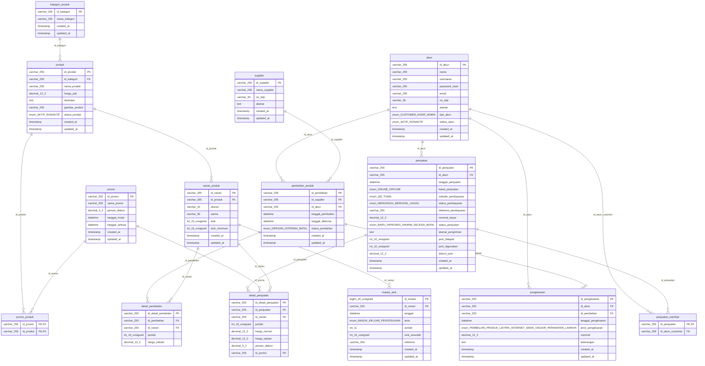

# ERD dan Physical Data Model (PDM)

> Dihasilkan otomatis dari database hasil `php artisan migrate`, sehingga selalu sama dengan implementasi aktual.
> Diagram memakai Mermaid: tampil langsung di GitHub, atau salin ke <https://mermaid.live> untuk diekspor menjadi gambar laporan.

## 1. Database OLTP (`umkm_pakaian`)

14 tabel, 17 relasi foreign key.

### Rincian tabel OLTP

#### `akun`

| Kolom | Tipe | Null | Kunci | Keterangan |
| --- | --- | --- | --- | --- |
| `id_akun` | `varchar(255)` | Tidak | PK |  |
| `nama` | `varchar(255)` | Tidak |  |  |
| `username` | `varchar(255)` | Tidak | UNIQUE |  |
| `password_hash` | `varchar(255)` | Tidak |  |  |
| `email` | `varchar(255)` | Ya | UNIQUE |  |
| `no_telp` | `varchar(30)` | Tidak |  |  |
| `alamat` | `text` | Ya |  |  |
| `tipe_akun` | `enum('CUSTOMER','KASIR','ADMIN')` | Tidak |  |  |
| `status_akun` | `enum('AKTIF','NONAKTIF')` | Tidak |  | default 'AKTIF' |
| `created_at` | `timestamp` | Ya |  |  |
| `updated_at` | `timestamp` | Ya |  |  |

#### `detail_pembelian`

| Kolom | Tipe | Null | Kunci | Keterangan |
| --- | --- | --- | --- | --- |
| `id_detail_pembelian` | `varchar(255)` | Tidak | PK |  |
| `id_pembelian` | `varchar(255)` | Tidak | FK → pembelian_produk.id_pembelian |  |
| `id_varian` | `varchar(255)` | Tidak | FK → varian_produk.id_varian |  |
| `jumlah` | `int(10) unsigned` | Tidak |  |  |
| `harga_satuan` | `decimal(12,2)` | Tidak |  |  |

#### `detail_penjualan`

| Kolom | Tipe | Null | Kunci | Keterangan |
| --- | --- | --- | --- | --- |
| `id_detail_penjualan` | `varchar(255)` | Tidak | PK |  |
| `id_penjualan` | `varchar(255)` | Tidak | FK → penjualan.id_penjualan |  |
| `id_varian` | `varchar(255)` | Tidak | FK → varian_produk.id_varian |  |
| `jumlah` | `int(10) unsigned` | Tidak |  |  |
| `harga_normal` | `decimal(12,2)` | Tidak |  | default 0.00 |
| `harga_satuan` | `decimal(12,2)` | Tidak |  |  |
| `persen_diskon` | `decimal(5,2)` | Tidak |  | default 0.00 |
| `id_promo` | `varchar(255)` | Ya | FK → promo.id_promo |  |

#### `kategori_produk`

| Kolom | Tipe | Null | Kunci | Keterangan |
| --- | --- | --- | --- | --- |
| `id_kategori` | `varchar(255)` | Tidak | PK |  |
| `nama_kategori` | `varchar(255)` | Tidak | UNIQUE |  |
| `created_at` | `timestamp` | Ya |  |  |
| `updated_at` | `timestamp` | Ya |  |  |

#### `mutasi_stok`

| Kolom | Tipe | Null | Kunci | Keterangan |
| --- | --- | --- | --- | --- |
| `id_mutasi` | `bigint(20) unsigned` | Tidak | PK | auto increment |
| `id_varian` | `varchar(255)` | Tidak | FK → varian_produk.id_varian |  |
| `tanggal` | `datetime` | Tidak |  |  |
| `jenis` | `enum('MASUK','KELUAR','PENYESUAIAN')` | Tidak |  |  |
| `jumlah` | `int(11)` | Tidak |  |  |
| `stok_sesudah` | `int(10) unsigned` | Tidak |  |  |
| `referensi` | `varchar(255)` | Ya |  |  |
| `created_at` | `timestamp` | Ya |  |  |
| `updated_at` | `timestamp` | Ya |  |  |

#### `pembelian_produk`

| Kolom | Tipe | Null | Kunci | Keterangan |
| --- | --- | --- | --- | --- |
| `id_pembelian` | `varchar(255)` | Tidak | PK |  |
| `id_supplier` | `varchar(255)` | Tidak | FK → supplier.id_supplier |  |
| `id_akun` | `varchar(255)` | Tidak | FK → akun.id_akun |  |
| `tanggal_pembelian` | `datetime` | Tidak |  |  |
| `tanggal_diterima` | `datetime` | Ya |  |  |
| `status_pembelian` | `enum('DIPESAN','DITERIMA','BATAL')` | Tidak |  | default 'DIPESAN' |
| `created_at` | `timestamp` | Ya |  |  |
| `updated_at` | `timestamp` | Ya |  |  |

#### `pengeluaran`

| Kolom | Tipe | Null | Kunci | Keterangan |
| --- | --- | --- | --- | --- |
| `id_pengeluaran` | `varchar(255)` | Tidak | PK |  |
| `id_akun` | `varchar(255)` | Tidak | FK → akun.id_akun |  |
| `id_pembelian` | `varchar(255)` | Ya | FK → pembelian_produk.id_pembelian, UNIQUE |  |
| `tanggal_pengeluaran` | `datetime` | Tidak |  |  |
| `jenis_pengeluaran` | `enum('PEMBELIAN_PRODUK','LISTRIK','INTERNET','SEWA','ONGKIR','PERAWATAN','LAINNYA')` | Tidak |  |  |
| `nominal` | `decimal(12,2)` | Tidak |  |  |
| `keterangan` | `text` | Ya |  |  |
| `created_at` | `timestamp` | Ya |  |  |
| `updated_at` | `timestamp` | Ya |  |  |

#### `penjualan`

| Kolom | Tipe | Null | Kunci | Keterangan |
| --- | --- | --- | --- | --- |
| `id_penjualan` | `varchar(255)` | Tidak | PK |  |
| `id_akun` | `varchar(255)` | Tidak | FK → akun.id_akun |  |
| `tanggal_penjualan` | `datetime` | Tidak |  |  |
| `kanal_penjualan` | `enum('ONLINE','OFFLINE')` | Tidak |  |  |
| `metode_pembayaran` | `enum('QR','TUNAI')` | Tidak |  |  |
| `status_pembayaran` | `enum('MENUNGGU','BERHASIL','GAGAL')` | Tidak |  | default 'MENUNGGU' |
| `referensi_pembayaran` | `varchar(255)` | Ya | UNIQUE |  |
| `nominal_bayar` | `decimal(12,2)` | Tidak |  | default 0.00 |
| `status_penjualan` | `enum('BARU','DIPROSES','DIKIRIM','SELESAI','BATAL')` | Tidak |  | default 'BARU' |
| `alamat_pengiriman` | `text` | Ya |  |  |
| `poin_didapat` | `int(10) unsigned` | Tidak |  | default 0 |
| `poin_digunakan` | `int(10) unsigned` | Tidak |  | default 0 |
| `diskon_poin` | `decimal(12,2)` | Tidak |  | default 0.00 |
| `created_at` | `timestamp` | Ya |  |  |
| `updated_at` | `timestamp` | Ya |  |  |

#### `penjualan_member`

| Kolom | Tipe | Null | Kunci | Keterangan |
| --- | --- | --- | --- | --- |
| `id_penjualan` | `varchar(255)` | Tidak | PK, FK → penjualan.id_penjualan |  |
| `id_akun_customer` | `varchar(255)` | Tidak | FK → akun.id_akun |  |

#### `produk`

| Kolom | Tipe | Null | Kunci | Keterangan |
| --- | --- | --- | --- | --- |
| `id_produk` | `varchar(255)` | Tidak | PK |  |
| `id_kategori` | `varchar(255)` | Tidak | FK → kategori_produk.id_kategori |  |
| `nama_produk` | `varchar(255)` | Tidak |  |  |
| `harga_jual` | `decimal(12,2)` | Tidak |  |  |
| `deskripsi` | `text` | Ya |  |  |
| `gambar_produk` | `varchar(255)` | Ya |  |  |
| `status_produk` | `enum('AKTIF','NONAKTIF')` | Tidak |  | default 'AKTIF' |
| `created_at` | `timestamp` | Ya |  |  |
| `updated_at` | `timestamp` | Ya |  |  |

#### `promo`

| Kolom | Tipe | Null | Kunci | Keterangan |
| --- | --- | --- | --- | --- |
| `id_promo` | `varchar(255)` | Tidak | PK |  |
| `nama_promo` | `varchar(255)` | Tidak |  |  |
| `persen_diskon` | `decimal(5,2)` | Tidak |  |  |
| `tanggal_mulai` | `datetime` | Tidak |  |  |
| `tanggal_selesai` | `datetime` | Tidak |  |  |
| `created_at` | `timestamp` | Ya |  |  |
| `updated_at` | `timestamp` | Ya |  |  |

#### `promo_produk`

| Kolom | Tipe | Null | Kunci | Keterangan |
| --- | --- | --- | --- | --- |
| `id_promo` | `varchar(255)` | Tidak | PK, FK → promo.id_promo |  |
| `id_produk` | `varchar(255)` | Tidak | PK, FK → produk.id_produk |  |

#### `supplier`

| Kolom | Tipe | Null | Kunci | Keterangan |
| --- | --- | --- | --- | --- |
| `id_supplier` | `varchar(255)` | Tidak | PK |  |
| `nama_supplier` | `varchar(255)` | Tidak |  |  |
| `no_telp` | `varchar(30)` | Tidak |  |  |
| `alamat` | `text` | Ya |  |  |
| `created_at` | `timestamp` | Ya |  |  |
| `updated_at` | `timestamp` | Ya |  |  |

#### `varian_produk`

| Kolom | Tipe | Null | Kunci | Keterangan |
| --- | --- | --- | --- | --- |
| `id_varian` | `varchar(255)` | Tidak | PK |  |
| `id_produk` | `varchar(255)` | Tidak | FK → produk.id_produk |  |
| `ukuran` | `varchar(10)` | Tidak |  |  |
| `warna` | `varchar(50)` | Tidak |  |  |
| `stok` | `int(10) unsigned` | Tidak |  | default 0 |
| `stok_minimum` | `int(10) unsigned` | Tidak |  | default 0 |
| `created_at` | `timestamp` | Ya |  |  |
| `updated_at` | `timestamp` | Ya |  |  |

## 2. Database Data Warehouse (`umkm_dw`)

11 tabel (3 fakta + 8 dimensi), 13 relasi foreign key.

```mermaid
erDiagram
    dim_customer {
        int_10_unsigned customer_key PK
        varchar_255 id_akun
        varchar_255 nama
        varchar_255 username
        varchar_10 status_akun
        date tanggal_daftar
        smallint_5_unsigned tahun_daftar
    }
    dim_jenis_pengeluaran {
        int_10_unsigned jenis_pengeluaran_key PK
        varchar_30 jenis_pengeluaran
        varchar_30 kelompok
    }
    dim_produk {
        int_10_unsigned produk_key PK
        varchar_255 id_varian
        varchar_10 ukuran
        varchar_50 warna
        int_10_unsigned stok_minimum
        varchar_255 id_produk
        varchar_255 nama_produk
        decimal_12_2 harga_jual
        varchar_10 status_produk
        varchar_255 id_kategori
        varchar_255 nama_kategori
    }
    dim_promo {
        int_10_unsigned promo_key PK
        varchar_255 id_promo
        varchar_255 nama_promo
        decimal_5_2 persen_diskon
        datetime tanggal_mulai
        datetime tanggal_selesai
        int_11 durasi_hari
        varchar_20 kelompok_diskon
    }
    dim_staf {
        int_10_unsigned staf_key PK
        varchar_255 id_akun
        varchar_255 nama
        varchar_10 peran
        varchar_10 status_akun
    }
    dim_supplier {
        int_10_unsigned supplier_key PK
        varchar_255 id_supplier
        varchar_255 nama_supplier
        text alamat
    }
    dim_transaksi {
        int_10_unsigned transaksi_key PK
        varchar_10 kanal_penjualan
        varchar_10 metode_pembayaran
    }
    dim_waktu {
        int_10_unsigned waktu_key PK
        date tanggal
        tinyint_3_unsigned hari
        varchar_15 nama_hari
        tinyint_3_unsigned hari_dalam_minggu
        tinyint_1 is_akhir_pekan
        tinyint_3_unsigned minggu_dalam_tahun
        tinyint_3_unsigned bulan
        varchar_15 nama_bulan
        tinyint_3_unsigned kuartal
        tinyint_3_unsigned semester
        smallint_5_unsigned tahun
    }
    fact_pembelian {
        bigint_20_unsigned pembelian_fact_id PK
        int_10_unsigned waktu_key FK
        int_10_unsigned produk_key FK
        int_10_unsigned supplier_key FK
        int_10_unsigned staf_key FK
        varchar_255 id_pembelian
        varchar_255 id_detail_pembelian
        int_11 jumlah
        decimal_12_2 harga_beli
        decimal_14_2 total_biaya
    }
    fact_pengeluaran {
        bigint_20_unsigned pengeluaran_fact_id PK
        int_10_unsigned waktu_key FK
        int_10_unsigned jenis_pengeluaran_key FK
        int_10_unsigned staf_key FK
        varchar_255 id_pengeluaran
        decimal_14_2 nominal
    }
    fact_penjualan {
        bigint_20_unsigned penjualan_fact_id PK
        int_10_unsigned waktu_key FK
        int_10_unsigned produk_key FK
        int_10_unsigned customer_key FK
        int_10_unsigned staf_key FK
        int_10_unsigned promo_key FK
        int_10_unsigned transaksi_key FK
        varchar_255 id_penjualan
        varchar_255 id_detail_penjualan
        int_11 jumlah
        decimal_12_2 harga_normal
        decimal_12_2 harga_satuan
        decimal_14_2 diskon_promo
        decimal_14_2 subtotal
        decimal_14_2 diskon_poin
        decimal_14_2 pendapatan_bersih
        decimal_14_2 hpp
        decimal_14_2 laba_kotor
    }
    dim_produk ||--o{ fact_pembelian : "produk_key"
    dim_staf ||--o{ fact_pembelian : "staf_key"
    dim_supplier ||--o{ fact_pembelian : "supplier_key"
    dim_waktu ||--o{ fact_pembelian : "waktu_key"
    dim_jenis_pengeluaran ||--o{ fact_pengeluaran : "jenis_pengeluaran_key"
    dim_staf ||--o{ fact_pengeluaran : "staf_key"
    dim_waktu ||--o{ fact_pengeluaran : "waktu_key"
    dim_customer ||--o{ fact_penjualan : "customer_key"
    dim_produk ||--o{ fact_penjualan : "produk_key"
    dim_promo ||--o{ fact_penjualan : "promo_key"
    dim_staf ||--o{ fact_penjualan : "staf_key"
    dim_transaksi ||--o{ fact_penjualan : "transaksi_key"
    dim_waktu ||--o{ fact_penjualan : "waktu_key"
```

### Rincian tabel DW

#### `dim_customer`

| Kolom | Tipe | Null | Kunci | Keterangan |
| --- | --- | --- | --- | --- |
| `customer_key` | `int(10) unsigned` | Tidak | PK | auto increment |
| `id_akun` | `varchar(255)` | Tidak | UNIQUE |  |
| `nama` | `varchar(255)` | Ya |  |  |
| `username` | `varchar(255)` | Ya |  |  |
| `status_akun` | `varchar(10)` | Ya |  |  |
| `tanggal_daftar` | `date` | Ya |  |  |
| `tahun_daftar` | `smallint(5) unsigned` | Ya |  |  |

#### `dim_jenis_pengeluaran`

| Kolom | Tipe | Null | Kunci | Keterangan |
| --- | --- | --- | --- | --- |
| `jenis_pengeluaran_key` | `int(10) unsigned` | Tidak | PK |  |
| `jenis_pengeluaran` | `varchar(30)` | Tidak | UNIQUE |  |
| `kelompok` | `varchar(30)` | Tidak |  |  |

#### `dim_produk`

| Kolom | Tipe | Null | Kunci | Keterangan |
| --- | --- | --- | --- | --- |
| `produk_key` | `int(10) unsigned` | Tidak | PK | auto increment |
| `id_varian` | `varchar(255)` | Tidak | UNIQUE |  |
| `ukuran` | `varchar(10)` | Tidak |  |  |
| `warna` | `varchar(50)` | Tidak |  |  |
| `stok_minimum` | `int(10) unsigned` | Tidak |  | default 0 |
| `id_produk` | `varchar(255)` | Tidak |  |  |
| `nama_produk` | `varchar(255)` | Tidak |  |  |
| `harga_jual` | `decimal(12,2)` | Tidak |  |  |
| `status_produk` | `varchar(10)` | Tidak |  |  |
| `id_kategori` | `varchar(255)` | Tidak |  |  |
| `nama_kategori` | `varchar(255)` | Tidak |  |  |

#### `dim_promo`

| Kolom | Tipe | Null | Kunci | Keterangan |
| --- | --- | --- | --- | --- |
| `promo_key` | `int(10) unsigned` | Tidak | PK | auto increment |
| `id_promo` | `varchar(255)` | Tidak | UNIQUE |  |
| `nama_promo` | `varchar(255)` | Ya |  |  |
| `persen_diskon` | `decimal(5,2)` | Ya |  |  |
| `tanggal_mulai` | `datetime` | Ya |  |  |
| `tanggal_selesai` | `datetime` | Ya |  |  |
| `durasi_hari` | `int(11)` | Ya |  |  |
| `kelompok_diskon` | `varchar(20)` | Ya |  |  |

#### `dim_staf`

| Kolom | Tipe | Null | Kunci | Keterangan |
| --- | --- | --- | --- | --- |
| `staf_key` | `int(10) unsigned` | Tidak | PK | auto increment |
| `id_akun` | `varchar(255)` | Tidak | UNIQUE |  |
| `nama` | `varchar(255)` | Ya |  |  |
| `peran` | `varchar(10)` | Ya |  |  |
| `status_akun` | `varchar(10)` | Ya |  |  |

#### `dim_supplier`

| Kolom | Tipe | Null | Kunci | Keterangan |
| --- | --- | --- | --- | --- |
| `supplier_key` | `int(10) unsigned` | Tidak | PK | auto increment |
| `id_supplier` | `varchar(255)` | Tidak | UNIQUE |  |
| `nama_supplier` | `varchar(255)` | Ya |  |  |
| `alamat` | `text` | Ya |  |  |

#### `dim_transaksi`

| Kolom | Tipe | Null | Kunci | Keterangan |
| --- | --- | --- | --- | --- |
| `transaksi_key` | `int(10) unsigned` | Tidak | PK |  |
| `kanal_penjualan` | `varchar(10)` | Tidak |  |  |
| `metode_pembayaran` | `varchar(10)` | Tidak |  |  |

#### `dim_waktu`

| Kolom | Tipe | Null | Kunci | Keterangan |
| --- | --- | --- | --- | --- |
| `waktu_key` | `int(10) unsigned` | Tidak | PK |  |
| `tanggal` | `date` | Tidak | UNIQUE |  |
| `hari` | `tinyint(3) unsigned` | Tidak |  |  |
| `nama_hari` | `varchar(15)` | Tidak |  |  |
| `hari_dalam_minggu` | `tinyint(3) unsigned` | Tidak |  |  |
| `is_akhir_pekan` | `tinyint(1)` | Tidak |  | default 0 |
| `minggu_dalam_tahun` | `tinyint(3) unsigned` | Tidak |  |  |
| `bulan` | `tinyint(3) unsigned` | Tidak |  |  |
| `nama_bulan` | `varchar(15)` | Tidak |  |  |
| `kuartal` | `tinyint(3) unsigned` | Tidak |  |  |
| `semester` | `tinyint(3) unsigned` | Tidak |  |  |
| `tahun` | `smallint(5) unsigned` | Tidak |  |  |

#### `fact_pembelian`

| Kolom | Tipe | Null | Kunci | Keterangan |
| --- | --- | --- | --- | --- |
| `pembelian_fact_id` | `bigint(20) unsigned` | Tidak | PK | auto increment |
| `waktu_key` | `int(10) unsigned` | Tidak | FK → dim_waktu.waktu_key |  |
| `produk_key` | `int(10) unsigned` | Tidak | FK → dim_produk.produk_key |  |
| `supplier_key` | `int(10) unsigned` | Tidak | FK → dim_supplier.supplier_key |  |
| `staf_key` | `int(10) unsigned` | Tidak | FK → dim_staf.staf_key |  |
| `id_pembelian` | `varchar(255)` | Tidak |  |  |
| `id_detail_pembelian` | `varchar(255)` | Tidak | UNIQUE |  |
| `jumlah` | `int(11)` | Tidak |  |  |
| `harga_beli` | `decimal(12,2)` | Tidak |  |  |
| `total_biaya` | `decimal(14,2)` | Tidak |  |  |

#### `fact_pengeluaran`

| Kolom | Tipe | Null | Kunci | Keterangan |
| --- | --- | --- | --- | --- |
| `pengeluaran_fact_id` | `bigint(20) unsigned` | Tidak | PK | auto increment |
| `waktu_key` | `int(10) unsigned` | Tidak | FK → dim_waktu.waktu_key |  |
| `jenis_pengeluaran_key` | `int(10) unsigned` | Tidak | FK → dim_jenis_pengeluaran.jenis_pengeluaran_key |  |
| `staf_key` | `int(10) unsigned` | Tidak | FK → dim_staf.staf_key |  |
| `id_pengeluaran` | `varchar(255)` | Tidak | UNIQUE |  |
| `nominal` | `decimal(14,2)` | Tidak |  |  |

#### `fact_penjualan`

| Kolom | Tipe | Null | Kunci | Keterangan |
| --- | --- | --- | --- | --- |
| `penjualan_fact_id` | `bigint(20) unsigned` | Tidak | PK | auto increment |
| `waktu_key` | `int(10) unsigned` | Tidak | FK → dim_waktu.waktu_key |  |
| `produk_key` | `int(10) unsigned` | Tidak | FK → dim_produk.produk_key |  |
| `customer_key` | `int(10) unsigned` | Tidak | FK → dim_customer.customer_key |  |
| `staf_key` | `int(10) unsigned` | Tidak | FK → dim_staf.staf_key |  |
| `promo_key` | `int(10) unsigned` | Tidak | FK → dim_promo.promo_key |  |
| `transaksi_key` | `int(10) unsigned` | Tidak | FK → dim_transaksi.transaksi_key |  |
| `id_penjualan` | `varchar(255)` | Tidak |  |  |
| `id_detail_penjualan` | `varchar(255)` | Tidak | UNIQUE |  |
| `jumlah` | `int(11)` | Tidak |  |  |
| `harga_normal` | `decimal(12,2)` | Tidak |  |  |
| `harga_satuan` | `decimal(12,2)` | Tidak |  |  |
| `diskon_promo` | `decimal(14,2)` | Tidak |  |  |
| `subtotal` | `decimal(14,2)` | Tidak |  |  |
| `diskon_poin` | `decimal(14,2)` | Tidak |  |  |
| `pendapatan_bersih` | `decimal(14,2)` | Tidak |  |  |
| `hpp` | `decimal(14,2)` | Tidak |  |  |
| `laba_kotor` | `decimal(14,2)` | Tidak |  |  |

