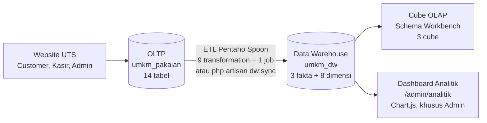
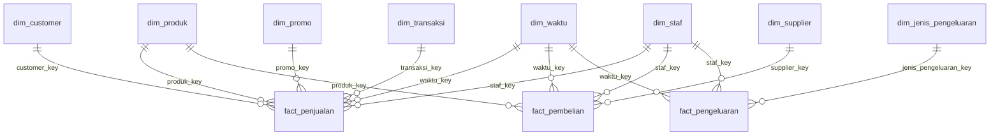

# Panduan UAS: Data Warehouse FORMA Fashion

Dokumen ini adalah **ringkasan satu tempat** untuk memahami, menjalankan, dan mempertahankan proyek di depan dosen. Semua angka di sini berasal dari data seeder final (tanggal tetap) dan sudah diperiksa ulang lewat tes otomatis serta query rekonsiliasi.

Dokumen pendukung:
[ERD_PDM.md](ERD_PDM.md) (ERD dan PDM, dibuat otomatis dari database) ·
[KONSEP_UAS_DATA_WAREHOUSE.md](KONSEP_UAS_DATA_WAREHOUSE.md) (konsep dan perencanaan awal; bila ada beda, **dokumen ini dan kodenya yang berlaku**).

---

## 1. Gambaran sistem dalam satu menit

FORMA Fashion adalah toko pakaian UMKM dengan dua jalur penjualan: **online** (customer memesan lewat website) dan **offline** (kasir memakai POS). Admin mengelola produk, pembelian dari supplier, promo, dan pengeluaran.

Data operasional disimpan di database **OLTP** (`umkm_pakaian`). Untuk analisis, data disalin dan dibentuk ulang oleh proses **ETL** ke database **Data Warehouse** (`umkm_dw`) berbentuk *star schema*. Dari DW dibuat kubus **OLAP** dan **dashboard** di website.



Pemenuhan target UAS:

| Target | Status | Bukti |
| --- | --- | --- |
| Website UTS tetap berfungsi | Ya | 12 tes `FinalSystemSmokeTest` lulus |
| 3 tabel fakta, 8 dimensi | Ya | `database/dw/umkm_dw_schema.sql`, [ERD_PDM.md](ERD_PDM.md) |
| 9 transformation + 1 job ETL | Ya, **sudah dijalankan di Pentaho** | `database/dw/pentaho/` |
| 3 cube OLAP | Ya, **sudah dites lewat Mondrian** | `database/dw/umkm_dw_olap_schema.xml` |
| Dashboard Laravel dari DW, khusus Admin | Ya | `AnalyticsController`, tes RBAC |
| Pengujian terdokumentasi | Ya | bagian 7 dokumen ini |

---

## 2. Menjalankan dari nol

Prasyarat: PHP 8.2, Composer, MySQL (XAMPP), Pentaho Data Integration (opsional).

```powershell
copy .env.example .env
php artisan key:generate
composer install

# buat dua database kosong: umkm_pakaian dan umkm_dw (phpMyAdmin atau mysql)
php artisan migrate:fresh --seed                                    # OLTP + data 12 bulan
php artisan migrate --database=dw --path=database/migrations/dw     # struktur DW
php artisan dw:sync                                                 # ETL: dimensi lalu fakta
php artisan serve
```

Login admin: `admin` / `admin123`, lalu buka **/admin/analitik**. Daftar akun lain ada di README.

Cara alternatif tanpa seeder: impor `database/dump/umkm_pakaian_oltp.sql` ke `umkm_pakaian` dan `database/dump/umkm_dw.sql` ke `umkm_dw`.

Pengecekan kualitas data OLTP kapan saja:

```powershell
mysql -uroot umkm_pakaian < database/audit_oltp.sql
```

Semua baris hasil harus `PASS` (24 pemeriksaan).

---

## 3. Database OLTP

14 tabel, lengkap di [ERD_PDM.md](ERD_PDM.md). Kelompoknya:

| Kelompok | Tabel |
| --- | --- |
| Pengguna | `akun` (`tipe_akun`: CUSTOMER, KASIR, ADMIN) |
| Produk | `kategori_produk`, `produk`, `varian_produk` (ukuran x warna, menyimpan `stok`) |
| Penjualan | `penjualan`, `detail_penjualan`, `penjualan_member` |
| Pembelian | `supplier`, `pembelian_produk`, `detail_pembelian` |
| Keuangan | `pengeluaran` |
| Promo | `promo`, `promo_produk` |
| Kartu stok | `mutasi_stok` (MASUK, KELUAR, PENYESUAIAN) |

Aturan bisnis yang menentukan isi data:

- Harga setelah promo disimpan di `detail_penjualan` sebagai *snapshot*: `harga_normal`, `persen_diskon`, `id_promo`, `harga_satuan`. Perubahan harga atau promo di kemudian hari tidak mengubah transaksi lama.
- 1 poin = Rp500, didapat 1 poin per Rp10.000. `nominal_bayar` = subtotal dikurangi `diskon_poin`.
- Stok **bertambah hanya saat pembelian DITERIMA** (sekaligus mencatat `tanggal_diterima`, `mutasi_stok` MASUK, dan satu `pengeluaran` PEMBELIAN_PRODUK). Stok **berkurang saat penjualan** dibuat.
- Pembayaran GAGAL atau pesanan BATAL tidak mengurangi stok dan tidak dihitung sebagai pendapatan.

### Data dummy (seeder `PrototypeSeeder`)

Periode **1 Des 2025 sampai 30 Nov 2026** (12 bulan kalender penuh), tanggal tetap dan seed acak tetap, jadi hasilnya sama di semua laptop. Simulasi berjalan hari demi hari:

1. 1 Des 2025: toko membuka stok awal (6 pembelian, satu per supplier, diterima pukul 08:00), sebelum transaksi pertama pukul 09:00.
2. Setiap hari tercatat 6 sampai 16 transaksi (lebih ramai akhir pekan dan musim promo).
3. Setiap Senin dan Kamis, varian yang stoknya menyentuh titik pesan ulang dipesan ke supplier tetapnya; barang tiba 2 sampai 4 hari kemudian. Sebagian kecil pembelian BATAL, dan pesanan di hari terakhir masih DIPESAN.
4. Penjualan hanya mengambil stok yang ada, maka **stok tidak pernah minus**.
5. Akun customer dibuat sebelum transaksi pertamanya.

Ukuran data final:

| Data | Jumlah |
| --- | --- |
| Akun (customer / kasir / admin) | 160 / 4 / 2 |
| Kategori / produk / varian / supplier / promo | 6 / 32 / 319 / 6 / 10 |
| Penjualan (semua / valid) | 3.448 / 3.363 |
| Detail penjualan | 6.922 |
| Pembelian (DITERIMA / DIPESAN / BATAL) | 562 / 6 / 40 |
| Pengeluaran | 628 |
| Mutasi stok | 9.238 |

---

## 4. Rancangan Data Warehouse

### 4.1 Tiga bintang



Tiga fakta memakai dimensi bersama (`dim_waktu`, `dim_staf`, `dim_produk`), sehingga bentuknya *fact constellation* (galaxy schema) dan bisa dibandingkan lintas fakta (misalnya arus kas bulanan).

### 4.2 Tabel fakta

| Fakta | Grain (satu baris =) | Ukuran |
| --- | --- | --- |
| `fact_penjualan` | satu varian produk dalam satu transaksi penjualan yang **BERHASIL dan bukan BATAL** | `jumlah`, `harga_normal`, `harga_satuan`, `diskon_promo`, `subtotal`, `diskon_poin`, `pendapatan_bersih`, `hpp`, `laba_kotor` |
| `fact_pembelian` | satu varian produk dalam satu pembelian **DITERIMA** | `jumlah`, `harga_beli`, `total_biaya` |
| `fact_pengeluaran` | satu catatan pengeluaran | `nominal` |

Rumus ukuran penjualan (per baris):

```
subtotal          = jumlah x harga_satuan                 (harga_satuan sudah setelah promo)
diskon_promo      = (harga_normal - harga_satuan) x jumlah
diskon_poin       = diskon poin transaksi, dibagi ke tiap baris sebanding subtotal baris
pendapatan_bersih = subtotal - diskon_poin                (jumlah seluruh baris satu transaksi = nominal_bayar)
hpp               = jumlah x harga beli rata-rata tertimbang varian itu
laba_kotor        = pendapatan_bersih - hpp
```

### 4.3 Tabel dimensi

| Dimensi | Isi utama | Catatan |
| --- | --- | --- |
| `dim_waktu` | tanggal, hari, minggu, bulan, kuartal, semester, tahun | `waktu_key` = YYYYMMDD; 1 Jan 2025 sampai 31 Des 2027 |
| `dim_produk` | varian, ukuran, warna, produk, kategori | gabungan 3 tabel OLTP (denormalisasi); hierarki Kategori > Produk > Ukuran > Warna |
| `dim_customer` | nama, status, tanggal daftar | `customer_key` 0 = *GUEST / Non-member* |
| `dim_staf` | kasir dan admin | `staf_key` 0 = *Tidak ada (online)* |
| `dim_promo` | nama, persen, periode, kelompok diskon | `promo_key` 0 = *Tanpa promo* |
| `dim_transaksi` | kanal x metode bayar | *junk dimension*, 4 baris statis |
| `dim_supplier` | nama, alamat | |
| `dim_jenis_pengeluaran` | jenis dan kelompok | 7 baris statis; kelompok PEMBELIAN STOK atau OPERASIONAL |

Setiap dimensi punya **surrogate key** (`*_key`) dan **natural key** dari OLTP (`id_*`, unik). Dimensi memakai pembaruan tipe 1 (data lama ditimpa) karena kebutuhan analisis hanya melihat kondisi terkini.

---

## 5. ETL

Dua jalur yang hasilnya sama persis:

| Jalur | Cara | Kegunaan |
| --- | --- | --- |
| **Pentaho Spoon** | buka `database/dw/pentaho/job_etl_umkm_dw.kjb`, Run | jalur resmi untuk laporan dan screenshot |
| **Artisan** | `php artisan dw:sync` | otomatis (terjadwal tiap jam) dan tombol "Refresh Data Warehouse" di dashboard |

Urutan job: `01_dim_waktu`, `02_dim_produk`, `03_dim_customer`, `04_dim_staf`, `05_dim_promo`, `06_dim_supplier`, lalu `07_fact_penjualan`, `08_fact_pembelian`, `09_fact_pengeluaran`. Dimensi harus lebih dulu agar *lookup* surrogate key berhasil. Dua dimensi statis (`dim_transaksi`, `dim_jenis_pengeluaran`) diisi oleh DDL, bukan transformation.

Aturan ETL penting:

- **Filter penjualan**: hanya pembayaran BERHASIL dan status bukan BATAL. Transaksi gagal, batal, atau masih menunggu tidak masuk fakta.
- **Filter pembelian**: hanya DITERIMA, tanggalnya `tanggal_diterima` (saat uang dan barang benar-benar berpindah).
- **Penjualan online**: `staf_key` = 0 (tidak ada kasir). **Penjualan offline tanpa member**: `customer_key` = 0.
- **Idempoten**: dijalankan berulang tidak menggandakan data (upsert berdasarkan id detail). Artisan juga **membuang baris fakta yang sudah tidak valid** (misalnya transaksi yang dibatalkan setelah sempat dimuat).
- **Validasi**: `php artisan test` dan `database/dw/olap_queries.sql` bagian 1 membandingkan jumlah baris dan total rupiah OLTP dengan DW.

Terbukti: kedua jalur diuji pada data yang sama dan menghasilkan 6.743 / 2.492 / 628 baris fakta dengan 0 selisih (selisih per baris di bawah Rp0,01, hanya karena pembulatan di Pentaho).

---

## 6. OLAP dan dashboard

### 6.1 Tiga cube (`umkm_dw_olap_schema.xml`)

| Cube | Dimensi (hierarki) | Ukuran |
| --- | --- | --- |
| Penjualan | Waktu (Tahun > Semester > Kuartal > Bulan > Tanggal), Produk (Kategori > Produk > Ukuran > Warna), Customer, Kasir, Promo, Transaksi (Kanal > Metode Bayar) | Jumlah Terjual, Subtotal, Diskon Promo, Diskon Poin, Omzet, HPP, Laba Kotor, Jumlah Transaksi |
| Pembelian | Waktu, Produk, Supplier, Staf | Jumlah Dibeli, Total Biaya, Harga Beli Rata-rata |
| Pengeluaran | Waktu, Jenis Pengeluaran (Kelompok > Jenis), Staf | Total Pengeluaran, Jumlah Catatan |

Contoh MDX yang sudah dijalankan pada data final (bisa ditempel di jendela MDX Schema Workbench):

```
SELECT {[Measures].[Omzet],[Measures].[Jumlah Transaksi],[Measures].[Laba Kotor]} ON COLUMNS,
       {[Waktu].[Tahun].Members} ON ROWS FROM [Penjualan]
-- 2025: 242.075.100 | 350 | 96.619.694      2026: 2.082.788.630 | 3.013 | 833.022.836

SELECT {[Measures].[Omzet]} ON COLUMNS, {[Transaksi].[Kanal].Members} ON ROWS FROM [Penjualan]
-- OFFLINE 1.306.562.950   ONLINE 1.018.300.780

SELECT {[Measures].[Omzet]} ON COLUMNS, {[Produk].[Kategori].Members} ON ROWS
FROM [Penjualan] WHERE [Waktu].[2026]                                  -- slice tahun 2026

SELECT {[Measures].[Total Pengeluaran],[Measures].[Jumlah Catatan]} ON COLUMNS,
       {[Jenis Pengeluaran].[Jenis].Members} ON ROWS FROM [Pengeluaran]
```

Penjumlahan omzet 2025 dan 2026 (Rp2.324.863.730) sama dengan total di OLTP. Tahun 2027 muncul kosong karena `dim_waktu` disiapkan sampai 2027; gunakan `NON EMPTY` bila ingin menyembunyikannya.

Operasi OLAP dan contohnya (query SQL lengkap ada di `database/dw/olap_queries.sql`):

| Operasi | Contoh |
| --- | --- |
| Roll-up | harian ke bulanan ke kuartal ke tahun |
| Drill-down | kategori ke produk ke ukuran |
| Slice | satu tahun atau satu kanal |
| Dice | tahun 2026 **dan** kategori Jaket **dan** kanal ONLINE |
| Pivot | kategori x kanal, ukuran x warna |
| Drill-across | arus kas bulanan: `fact_penjualan` bersama `fact_pengeluaran` |

### 6.2 Dashboard `/admin/analitik`

Hanya Admin (kasir dan customer mendapat 403). Membaca langsung dari DW. Grafik: tren omzet dan laba, arus kas bulanan, omzet per kategori, produk terlaris, hari teramai, kanal dan metode bayar, member vs guest, komposisi pengeluaran, pembelian per supplier, plus tabel pivot ukuran x warna, efektivitas promo, top customer, dan kinerja kasir.

Cakupan filter (juga ditulis di halaman):

| Filter | Berlaku untuk |
| --- | --- |
| Tahun, Kuartal | semua grafik |
| Kategori | penjualan dan pembelian |
| Kanal | penjualan saja |

Pengeluaran dan arus kas tidak punya dimensi kategori atau kanal. Karena itu **arus kas hanya ditampilkan bila filter Kategori dan Kanal kosong**, agar omzet yang sudah terfilter tidak dikurangi pengeluaran total.

---

## 7. Hasil pengujian

### 7.1 Otomatis

`php artisan test`: **21 tes lulus**. Cakupan: login dan RBAC tiap peran, pembelian menambah stok sekali, validasi poin, pembayaran gagal tidak mengubah stok, pembatalan, snapshot harga promo, rekonsiliasi OLTP-DW, idempotensi dan pembersihan ETL, operasi OLAP, serta RBAC dashboard.

### 7.2 Kualitas data OLTP (`database/audit_oltp.sql`)

24 pemeriksaan, seluruhnya PASS. Contoh: stok minus 0, saldo `mutasi_stok` sama dengan stok varian, nominal bayar cocok dengan detail, promo hanya dalam periodenya dan hanya untuk produknya, customer tidak berbelanja sebelum mendaftar, pembelian DITERIMA selalu punya pengeluaran dengan nominal yang sama.

### 7.3 Rekonsiliasi OLTP dan DW (data final)

| Besaran | OLTP | DW |
| --- | --- | --- |
| Baris penjualan valid | 6.743 | 6.743 |
| Omzet | Rp2.324.863.730 | Rp2.324.863.730 |
| Baris pembelian DITERIMA | 2.492 | 2.492 |
| Total pembelian | Rp1.781.750.600 | Rp1.781.750.600 |
| Baris pengeluaran | 628 | 628 |
| Total pengeluaran | Rp1.883.312.523 | Rp1.883.312.523 |

### 7.4 Ringkasan angka bisnis

| Besaran | Nilai |
| --- | --- |
| Omzet bersih | Rp2.324.863.730 |
| HPP | Rp1.395.221.200 |
| Laba kotor (margin) | Rp929.642.530 (40,0%) |
| Pengeluaran total (operasional Rp101.561.923 + pembelian stok Rp1.781.750.600) | Rp1.883.312.523 |
| Arus kas (omzet dikurangi pengeluaran) | Rp441.551.207 |

---

## 8. Pertanyaan yang mungkin diajukan dosen

**Mengapa Data Warehouse dipisah dari database operasional?**
OLTP dioptimalkan untuk transaksi harian yang cepat dan konsisten (banyak tulis kecil). Analisis memerlukan agregasi besar dan riwayat. Memisahkannya menjaga performa website tetap cepat, dan DW boleh denormalisasi tanpa merusak aturan integritas OLTP.

**Mengapa star schema, bukan skema ternormalisasi?**
Query analitik cukup satu *join* dari fakta ke tiap dimensi. Sederhana, cepat, dan mudah dipahami pengguna bisnis.

**Apa grain `fact_penjualan` dan mengapa per item?**
Satu varian dalam satu transaksi. Grain terkecil dipilih supaya bisa diringkas ke atas (per produk, ukuran, hari, kanal) tanpa kehilangan detail.

**Mengapa transaksi gagal dan batal tidak masuk fakta?**
Pendapatan baru terjadi bila pembayaran berhasil dan pesanan tidak dibatalkan. Memasukkannya akan menggelembungkan omzet.

**Dari mana HPP dan laba kotor?**
HPP = jumlah x harga beli rata-rata tertimbang varian (dari seluruh pembelian DITERIMA). Pendekatan ini sederhana dan konsisten; keterbatasannya, harga rata-rata tidak mengikuti urutan waktu pembelian (bukan FIFO atau *moving average*).

**Mengapa ada baris dimensi dengan key 0?**
Penjualan offline tanpa member, pesanan online tanpa kasir, dan transaksi tanpa promo tidak punya pasangan di dimensi. Baris key 0 menjaga *foreign key* tetap valid dan membuat kelompok "Guest" atau "Tanpa promo" bisa dianalisis, tanpa nilai NULL.

**Apa itu `dim_transaksi`?**
*Junk dimension*: gabungan atribut kecil (kanal x metode bayar, 4 kombinasi) dalam satu tabel agar fakta tidak punya banyak kolom tersebar.

**Mengapa `fact_pembelian` dan `fact_pengeluaran` sama-sama memuat pembelian stok?**
`fact_pembelian` menjawab pertanyaan per produk dan supplier (apa, berapa, dari siapa). `fact_pengeluaran` menjawab arus uang keluar per jenis, termasuk pembelian stok sebagai salah satu jenis. Keduanya memandang uang yang sama dari sudut berbeda, jadi **jangan dijumlahkan**: arus kas memakai `fact_pengeluaran` saja.

**Mengapa dimensi memakai SCD tipe 1?**
Kebutuhan laporan hanya kondisi terkini. Riwayat harga sudah aman di `fact_penjualan` (`harga_normal`, `harga_satuan`) karena disimpan sebagai *snapshot* per transaksi.

**Mengapa ada Pentaho dan juga Artisan?**
Pentaho adalah ETL visual yang diwajibkan tugas. Artisan menjalankan logika yang sama agar dashboard bisa menyegarkan data dari website dan agar tes otomatis dapat memverifikasi hasilnya. Keduanya sudah dibandingkan: hasil identik.

**Bagaimana memastikan data DW benar?**
Rekonsiliasi jumlah baris dan total rupiah OLTP dengan DW (bagian 7.3), dijalankan otomatis oleh tes dan tersedia sebagai query di `olap_queries.sql`.

**Apakah ETL aman dijalankan berulang?**
Ya. Upsert berdasarkan id sumber, dan baris yang tidak valid lagi dibuang, sehingga DW selalu sama dengan OLTP.

**Mengapa `dim_waktu` sampai 2027?**
Menyediakan kalender ke depan agar transaksi baru tidak gagal *lookup*. Dashboard mengambil daftar tahun dari fakta, jadi tahun kosong tidak tampil.

**Apakah datanya asli?**
Data dummy hasil simulasi, tetapi konsisten secara bisnis (stok tidak minus, restock berdasarkan kebutuhan, promo sesuai periode) dan sama di semua komputer karena tanggal dan seed tetap.

**Mengapa arus kas hilang saat filter Kategori atau Kanal dipakai?**
Pengeluaran tidak punya dimensi tersebut. Menampilkan omzet per kategori dikurangi pengeluaran seluruh toko akan menyesatkan.

---

## 9. Keterbatasan (disampaikan jujur bila ditanya)

- HPP memakai rata-rata seluruh pembelian, bukan FIFO atau *moving average* menurut waktu.
- Dimensi tipe 1: perubahan nama produk atau status akun menimpa nilai lama di DW.
- Data dummy, sehingga pola bulanan (musiman, promo) adalah rancangan simulasi.
- ETL Artisan membaca ulang seluruh tabel sumber (cukup untuk ribuan baris, bukan jutaan). Untuk data besar perlu ETL inkremental berbasis tanggal ubah.
- Pengujian otomatis memakai SQLite di memori; pengujian MySQL dilakukan lewat query audit dan rekonsiliasi di atas.

---

## 10. Bukti yang perlu disiapkan per Bab (screenshot dan narasi)

| Bab | Bukti |
| --- | --- |
| III dan IV (OLTP) | [ERD_PDM.md](ERD_PDM.md) bagian 1, hasil `audit_oltp.sql` |
| IV dan V (DW) | [ERD_PDM.md](ERD_PDM.md) bagian 2, `umkm_dw_schema.sql`, hasil `SHOW TABLES` DW |
| V (ETL) | Spoon: 9 transformation dan job dengan log sukses; baris tiap dimensi dan fakta |
| V dan VIII (OLAP) | Schema Workbench: 3 cube, hasil MDX bagian 6.1 |
| VI (dashboard) | halaman `/admin/analitik` dengan dan tanpa filter |
| VII (pengujian) | `php artisan test`, tabel 7.3, `audit_oltp.sql`, pengujian *blackbox* dashboard |
