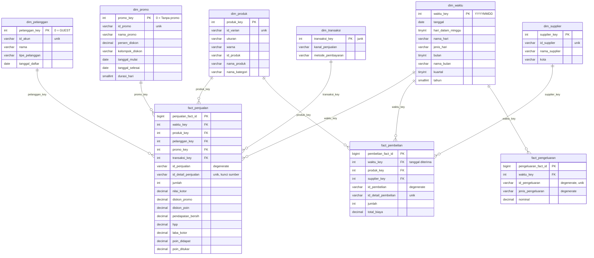

# Star Schema DW FORMA (`umkm_dw`)

Galaxy schema: 3 fakta berbagi dimensi conformed `dim_waktu` (dipakai 3 fakta) dan `dim_produk` (dipakai 2 fakta).
DDL: `database/migrations/dw/2026_11_25_000001_create_star_schema_umkm_dw.php` (setara `database/dw/umkm_dw_schema.sql`).

## Diagram

`etl_validasi` (log hasil rekonsiliasi setiap eksekusi job) adalah tabel metadata, bukan bagian star schema.

## Bus matrix

| Proses / Fakta | Waktu | Produk | Pelanggan | Promo | Transaksi | Supplier | Degenerate |
| :--- | :---: | :---: | :---: | :---: | :---: | :---: | :--- |
| Penjualan / `fact_penjualan` | ● | ● | ● | ● | ● | | id_penjualan |
| Pembelian / `fact_pembelian` | ● | ● | | | | ● | id_pembelian |
| Pengeluaran / `fact_pengeluaran` | ● | | | | | | id_pengeluaran, jenis_pengeluaran |

## Aturan integritas

- Semua FK fakta `NOT NULL` dengan foreign key ke dimensi. Baris yang kuncinya tidak ditemukan saat ETL ditolak database, sehingga job gagal (tidak dilewati diam-diam).
- Konsep "tidak ada" memakai baris kunci 0 (GUEST, Tanpa promo), bukan NULL.
- `id_detail_*` dan `id_pengeluaran` unik, mencegah baris ganda.
- Surrogate key dipakai untuk produk, pelanggan, promo, transaksi, dan supplier supaya DW tidak bergantung pada format ID OLTP. Waktu memakai smart key `YYYYMMDD` yang stabil dan mudah dibaca.

## Drill-across

Fakta tidak pernah di-JOIN langsung satu sama lain. Setiap fakta diagregasi sendiri pada dimensi bersama (bulan, kategori, varian), lalu hasil agregasinya digabung. Contoh SQL ada di `database/dw/olap_queries.sql` nomor 7 dan 8; di Mondrian dilakukan oleh virtual cube `Keuangan`.
